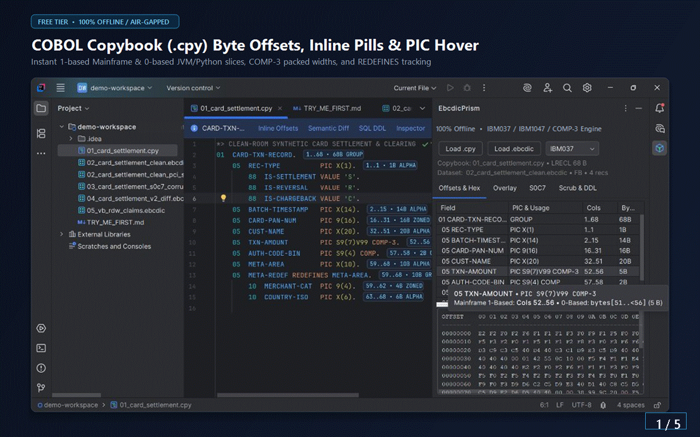

# EbcdicPrism Copybook Viewer — Offline COBOL Copybook, EBCDIC & COMP-3 Inspector for JetBrains IDEs

[-087CFA)](https://ediprism.github.io/cobol/)

**Deterministic, 100% offline / air-gapped mainframe binary data inspector, `COBOL Copybook` (`.cpy`) byte-offset calculator, `EBCDIC` / `COMP-3` / `Zoned Decimal` record overlay decoder, `S0C7` data-exception validator, semantic binary diff, and `PCI-DSS` test-fixture scrubber across all JetBrains IDEs** (`IntelliJ IDEA`, `DataGrip`, `PyCharm`, `Rider`, `GoLand`, `WebStorm`).

Built for core-banking, card-settlement, clearinghouse, insurance, airline, and retail mainframe modernization engineers who are barred by **PCI-DSS, SOX, GLBA, HIPAA, or NDA** from uploading production `.ebcdic` / `.ebc` extracts or proprietary `.cpy` schemas into browser hex viewers or cloud AI tools.

- **100% Local & Air-Gapped:** Zero backend servers, zero databases, zero telemetry, zero cloud or LLM API calls.
- **Cross-IDE Pure Platform:** Depends strictly on `com.intellij.modules.platform` — runs identically across `IntelliJ IDEA`, `DataGrip`, `PyCharm`, `Rider`, `GoLand`, and `WebStorm` (`2025.1`+) without requiring a COBOL compiler or Java plugin.

---

## Installation

- **Inside Any JetBrains IDE (`2025.1+`):** Open **Settings / Preferences** (`Ctrl+Alt+S` / `Cmd+,`) -> **Plugins** -> **Marketplace** -> search **`EbcdicPrism Copybook Viewer`** -> click **Install** (dynamic plugin — zero IDE restart required).
- **Documentation & Mainframe Reference Hub:** **[https://ediprism.github.io/cobol/](https://ediprism.github.io/cobol/)**

---

## Free Tier vs. `[Pro]` Feature Matrix

| Capability | Free Tier | `[Pro]` Tier (14-Day Free Trial) |
| :--- | :---: | :---: |
| **COBOL Copybook (`.cpy`, `.copy`, `.cobcopy`) Syntax Highlighting & Inline Offset Pills** | Yes | Yes |
| **Instant Hover & `Ctrl+Q` Byte-Offset Cards (`1`-Based Mainframe Cols + `0`-Based JVM/Python Slices + Total `LRECL`)** | Yes | Yes |
| **Native Read-Only `.ebcdic` / `.ebc` Paged Hex + Multi-Codepage Viewer (`Ctrl+F` Searchable)** | Yes | Yes |
| **7 Mainframe Codepages (`IBM037`, `IBM1047`, `IBM500`, `IBM273`, `IBM285`, `IBM297`, `IBM01140` Euro)** | Yes | Yes |
| **Fixed-Block (`FB`) & Variable-Blocked 4-Byte `RDW` (`VB`) Auto-Detection Banner** | Yes | Yes |
| **Zero Startup Nag Modals** | Yes | Yes |
| **Interactive Copybook-Over-Binary Record Decoder (`COMP-3`, Zoned Overpunch `{A-I`/`}J-R`, Big-Endian `COMP`, `REDEFINES`, `88` Flags)** | — | **Yes** |
| **Multi-Row Hex + EBCDIC Byte-to-`PIC` Hover Cards & Click-to-Sync Record Overlay** | — | **Yes** |
| **Background `S0C7` Invalid `COMP-3` Nibble & Broken `RDW`/`LRECL` Pinpointer** | — | **Yes** |
| **Semantic Binary Record Diff (`Alt+Shift+B` & Native `Ctrl+D`) Masking Header Timestamps** | — | **Yes** |
| **Deterministic Offline PCI-DSS Binary PAN (6-Digit BIN + Luhn Mod-10 Valid) & PII Scrubber (`Alt+Shift+R`)** | — | **Yes** |
| **1-Click Copybook-to-SQL `CREATE TABLE` DDL Generator + Offline JSON / CSV Record Export** | — | **Yes** |

---

## Quick Keyboard Shortcuts & Workflow

- **Hover Any `.cpy` Line or Press `Ctrl + Q`:** View exact `PIC & Usage`, 1-based JCL/`DFSORT` columns (`Cols 52..56`), 0-based half-open slices (`bytes[51..<56]`), `COMP-3` packed byte width, `OCCURS` stride, and `REDEFINES` targets.
- **`Ctrl + F` Inside Any `.ebcdic` / `.ebc` File:** Search across the `# Copybook PIC:` summary header, hex bytes, decoded `IBM037`/`IBM1047` text columns, or `[! S0C7]` diagnostic markers.
- **Hover or Click Any Hex / EBCDIC Byte in `.ebcdic`:** Highlights the full multi-byte field across both the Hex and EBCDIC panes, previews decoded values (including `REDEFINES` union branches), and syncs the right-hand **Overlay** tab on click.
- **`Alt + Shift + B`** *(or select two `.ebcdic` files in Project View and press **`Ctrl + D`**)*: Launch **Semantic Binary Diff `[Pro]`**, decoding both binary files through a shared `.cpy` layout while masking batch header timestamps/sequences.
- **`Alt + Shift + R`:** Run **Slice & PCI-Scrub Binary Test Fixture `[Pro]`**, replacing cardholder `PAN`s (preserving 6-digit issuer BINs and recomputing valid ISO/IEC 7812 Luhn Mod-10 check digits), SSNs, and names directly in binary without shifting a single byte offset.

---

## Mainframe Engineering & Troubleshooting Guides

- **[COBOL `COMP-3` Packed Decimal Byte Formula (`floor(N/2)+1`) & `S0C7` Abend Diagnostics](./guides/comp-3-packed-decimal-byte-formula-and-s0c7.md)**
- **[Calculating COBOL Copybook Byte Offsets Across `REDEFINES`, `OCCURS`, and 4-Byte `VB RDW` Headers](./guides/cobol-copybook-byte-offsets-redefines-and-vb-rdw.md)**
- **[Offline PCI-DSS Card PAN & PII Scrubbing Inside Binary `EBCDIC` Test Fixtures](./guides/offline-pci-dss-binary-pan-luhn-scrubber.md)**
- **[Full Interactive Reference Portal (`IBM037` vs `IBM1047` & Zoned Overpunch Tables)](https://ediprism.github.io/cobol/)**

---

## Sister Plugin in the EdiPrism Air-Gapped Suite

- **[EdiPrism X12 EDIFACT (`#35990`)](https://plugins.jetbrains.com/plugin/35990-ediprism-x12-edifact):** 100% offline `ASC X12` (`837`/`835`/`270`/`271`/`834`/`850`/`856`/`810`/`999`) & `UN/EDIFACT` (`ORDERS`/`DESADV`/`INVOIC`/`CONTRL`) loop inspector, semantic diff, `BigDecimal` balancing validator, and HIPAA Safe Harbor scrubber ([GitHub Docs](https://github.com/EdiPrism/ediprism)).

---

## Legal, Privacy & Support

- **Privacy & Air-Gapped Security Attestation:** [PRIVACY.md](./PRIVACY.md) • [ediprism.github.io/privacy.html](https://ediprism.github.io/privacy.html)
- **End-User License Agreement (EULA):** [EULA.md](./EULA.md) • [ediprism.github.io/eula.html](https://ediprism.github.io/eula.html)
- **Release Notes:** [CHANGELOG.md](./CHANGELOG.md)
- **Bug Reports & Feature Requests:** [GitHub Issues](https://github.com/EdiPrism/ebcdicprism/issues) • [Support Hub](https://ediprism.github.io/support.html)

*COBOL is an industry standard specification (INCITS/ISO/IEC 1989). IntelliJ IDEA, DataGrip, PyCharm, Rider, GoLand, and WebStorm are trademarks of JetBrains s.r.o. EbcdicPrism is an independent clean-room developer tool by EdiPrism and is not affiliated with, endorsed by, or sponsored by IBM Corporation or JetBrains s.r.o.*
